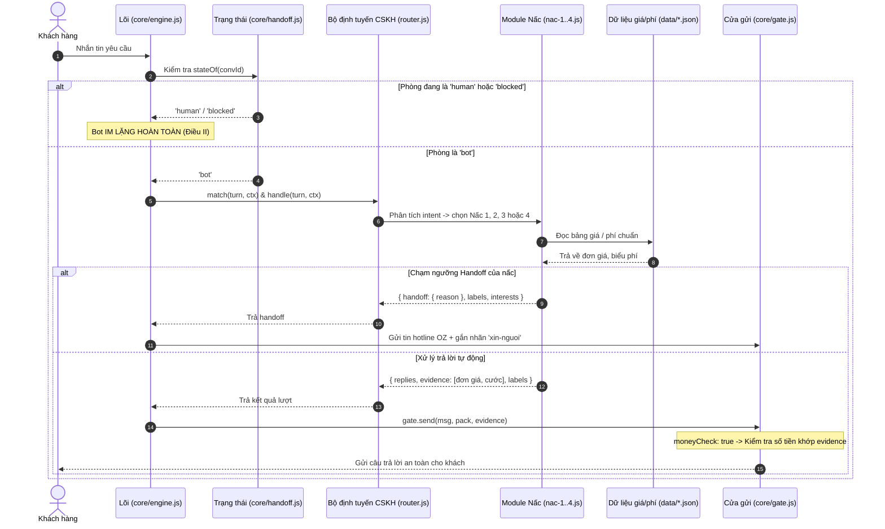

# Implementation Plan: Gói CSKH bốn nấc (Customer Care 4-Tier Funnel)

**Branch**: `003-cskh-bon-nac` | **Date**: 2026-11-10 | **Spec**: [spec.md](./spec.md)

**Input**: Feature specification from `specs/003-cskh-bon-nac/spec.md`

---

## Summary

Hiện thực hóa gói nghiệp vụ chăm sóc khách hàng bốn nấc (`packs/cskh/`) cho bot Zalo/Fanpage của OZ Việt Nam. Gói được thiết kế theo mô hình phễu chuyển đổi thông minh:
1. **Nấc 1**: Báo giá cước vận chuyển tạm tính (theo kg/m³) và cung cấp link sàn TMĐT phù hợp (1688, Taobao, Tmall, Alibaba).
2. **Nấc 2**: Hướng dẫn khách hàng tự tìm nguồn hàng chất lượng (tìm bằng hình ảnh, dịch từ khóa tiếng Trung, bộ 4 tiêu chí lọc xưởng uy tín trên 1688).
3. **Nấc 3**: Tư vấn gói dịch vụ tìm nguồn và đàm phán ủy thác trọn gói của OZ (biểu phí ủy thác minh bạch 1%–3%, cam kết pháp nhân).
4. **Nấc 4**: Tư vấn khóa đào tạo nhập khẩu 1-1 chuyên sâu (5 học phần thực chiến, thực hành ECUS5-VNACCS, đồng hành lô hàng đầu tiên).

Gói tuân thủ nghiêm ngặt hợp đồng gói `specs/001-nen-tang-chung/contracts/pack.md`, đặt cờ `moneyCheck: true` để khóa chặt 100% rủi ro bịa giá cước hoặc học phí theo Hiến pháp III, xác lập ranh giới chuyển giao nhân viên (`handoff`) rõ ràng tại từng nấc, và tôn trọng nguyên tắc "Người trước máy" (Hiến pháp II): khi phòng ở trạng thái `human` bot im hoàn toàn, khách im thì máy im (không tự gửi tin chăm sóc lại).

---

## Technical Context

**Language/Version**: JavaScript (ESM), Node.js ≥ 22.13 (Docker container `node:22-alpine`).

**Primary Dependencies**: 100% thư viện chuẩn Node.js, 0 dependency ngoài (Hiến pháp VI):
- `node:sqlite`: Cơ sở dữ liệu SQLite cục bộ `bot.db` qua `core/store.js` để lưu vết `messages`, `audit`, hồ sơ `customers`.
- `node:test`, `node:assert`: Viết và chạy kiểm thử tự động TDD cho gói CSKH.
- `core/gate.js`: Một cửa gửi duy nhất kiểm soát an toàn, trần tin, giờ yên và `moneyCheck`.
- `core/customers.js`: Quản lý hồ sơ khách hàng, tự động gắn nhãn (`labels`) và ghi nhận mặt hàng quan tâm (`interests`).
- `core/intents.js`: Nhận diện ý định gặp người (`wantsHuman`) và hỏi người hay máy (`asksIfBot`).
- `core/redact.js`: Lọc thông tin rò rỉ và che số điện thoại khách hàng.

**Module Structure (`packs/cskh/`)**:
```text
packs/cskh/
├── index.js               # Entry point, export pack object chuẩn contracts/pack.md
├── router.js              # Phân tích ý định & định tuyến vào 4 nấc CSKH
├── nac-1-bao-cuoc.js      # Nấc 1: Báo cước tạm tính & link sàn TMĐT
├── nac-2-huong-dan.js     # Nấc 2: Hướng dẫn tự tìm nguồn & lọc shop uy tín
├── nac-3-uy-thac.js       # Nấc 3: Gói dịch vụ tìm nguồn & đàm phán ủy thác
├── nac-4-dao-tao.js       # Nấc 4: Khóa đào tạo nhập khẩu 1-1 thực chiến
├── handoff-rules.js       # Kiểm tra điều kiện kích hoạt handoff tại từng nấc
├── data/
│   ├── bieu-cuoc.json     # Bảng biểu cước chuẩn (đơn giá theo kg, cbm, tuyến)
│   ├── phi-dich-vu.json   # Biểu phí dịch vụ tìm nguồn & ủy thác OZ
│   ├── hoc-phi-dao-tao.json # Học phí niêm yết khóa học 1-1 & lộ trình
│   ├── san-tmdt.json      # Danh mục link sàn & đặc thù từng sàn
│   └── tu-khoa-nganh.json # Từ điển từ khóa tiếng Trung theo ngành hàng
└── test/
    ├── cskh-pack.test.mjs # Test hợp đồng pack, router và priorities
    ├── nac-1.test.mjs     # Test tính cước, link sàn, moneyCheck Nấc 1
    ├── nac-2.test.mjs     # Test hướng dẫn tìm hàng, tiêu chí đầu trâu Nấc 2
    ├── nac-3.test.mjs     # Test dịch vụ ủy thác, biểu phí, RFQ Nấc 3
    ├── nac-4.test.mjs     # Test khóa học 1-1, học phí Nấc 4
    ├── handoff.test.mjs   # Test ranh giới handoff 4 nấc và hotline
    └── money-guard.test.mjs # Test từ chối số tiền bịa đặt (moneyCheck)
```

**Constraints**:
- Mỗi tệp mã nguồn mới dưới 300 dòng (Hiến pháp VI).
- 0 runtime dependency mới được thêm vào `package.json`.
- Gói `cskh` chỉ trả về dữ liệu qua hàm `handle()`, không gọi API gửi tin của kênh (Hiến pháp I).
- Bật `moneyCheck: true`, mọi số tiền trong văn bản phản hồi phải xuất hiện trong mảng `evidence` (Hiến pháp III).
- Khi phòng `conv_id` ở trạng thái `human` hoặc `blocked`, bot im lặng hoàn toàn (Hiến pháp II).
- Khi khách im lặng, tuyệt đối không có tác vụ nền nào tự phát gửi tin "chăm sóc lại" (Hiến pháp II).

---

## Constitution Check

*GATE: Đánh giá mức độ tuân thủ 9 điều Hiến pháp trước khi chi tiết hóa kiến trúc.*

| Điều | Đánh giá kiến trúc & Ràng buộc triển khai | Trạng thái |
|---|---|---|
| **I. Một cửa gửi** | Toàn bộ phản hồi của 4 nấc CSKH đi qua hàm `handle()`, trả về mảng `replies` để `core/engine.js` gửi qua `core/gate.js`. Gói tuyệt đối không có quyền gửi tin trực tiếp. Cửa gửi tiếp tục kiểm soát trần tin, giờ yên, rò rỉ bí mật và kiểm tra số tiền. | ✅ ĐẠT |
| **II. Người trước máy** | Phòng ở trạng thái `human` thì gói không được xử lý tin nhắn. Khi khách im lặng, không có cơ chế cron job hay timer nào tự ý gửi tin nhắn chăm sóc lại (chặn đứng triệt để sự cố #5 VPS 201). | ✅ ĐẠT |
| **III. Số tiền do code tra** | Bật `moneyCheck: true` trong pack manifest. Đơn giá cước, phí dịch vụ ủy thác và học phí bắt buộc nạp từ `packs/cskh/data/*.json` hoặc MCP Cổng OZ, nạp thẳng vào `evidence`. Cửa gửi `gate.send` sẽ từ chối (`reject`) nếu tin có số tiền không nằm trong `evidence`. | ✅ ĐẠT |
| **IV. Bằng chứng thắng lời khai** | Mọi lượt tư vấn CSKH đều ghi audit log đầy đủ (`audit.insert` loại `route`, `outbound`, `tool`). Toàn bộ 4 nấc được bảo vệ bởi test suite tự động và bộ kịch bản eval độc lập ≥ 30 hội thoại thực tế (`eval/run.mjs`). | ✅ ĐẠT |
| **V. Tri thức một nhà** | Tri thức biểu cước, phí dịch vụ, link sàn và học phí nằm trong thư mục dữ liệu `packs/cskh/data/` có cấu trúc rõ ràng hoặc MCP Cổng OZ. Không nhúng số liệu cứng vào câu prompt hay mã nguồn. | ✅ ĐẠT |
| **VI. Đơn giản, không phụ thuộc** | 0 dependency ngoài. Dùng 100% thư viện chuẩn Node.js. Mã nguồn phân tách thành 7 module nhỏ gọn, mỗi module dưới 300 dòng theo đúng Hiến pháp VI. | ✅ ĐẠT |
| **VII. Sai thì dừng** | Dữ liệu đầu vào không hợp lệ hoặc thiếu dữ kiện tính cước → hỏi lại nhẹ nhàng theo mẫu, không đoán mò khối lượng/giá cước. Lỗi ném ra từ `handle()` được lõi bắt và trả câu báo chung an toàn. | ✅ ĐẠT |
| **VIII. Trung thực với khách** | Khách hỏi "người hay máy" → lõi trả lời là trợ lý tự động OZ và gửi hotline. Không cam kết thời gian giao hàng phi thực tế khi gặp sự cố thiên tai/thông quan. Không hứa gửi file tài liệu khi chỉ gửi được chữ (sự cố #10). | ✅ ĐẠT |
| **IX. Bí mật không bao giờ lộ** | Che số điện thoại khách hàng, che giá vốn đàm phán nội bộ, không in token/API key vào tin nhắn hay log. Số điện thoại mẫu trong test chỉ dùng `0912345678`. | ✅ ĐẠT |

---

## Chi tiết Kiến trúc Kỹ thuật

### 1. Luồng tiếp nhận & Định tuyến 4 Nấc CSKH



### 2. Thiết kế Cơ chế Phòng vệ Số tiền (`moneyCheck: true`)

Để chặn đứng sự cố #6 (báo sai giá cước 27.000 đ/kg thay vì 25.650 đ/kg trên VPS 201), kiến trúc gói CSKH thiết lập cơ chế đồng bộ số liệu nghiêm ngặt:
1. Khi khách hỏi cước Nấc 1, hàm `tinhCuocTamTinh(loaiHang, khoiLuong, tuyen)` đọc dữ liệu từ `data/bieu-cuoc.json`.
2. Kết quả trả về gồm:
   ```js
   {
     donGia: 25650,
     khoiLuong: 300,
     tongCuoc: 7695000,
     tuyen: 'Quảng Châu - Hà Nội'
   }
   ```
3. Module `nac-1-bao-cuoc.js` nạp toàn bộ các giá trị số này vào mảng `evidence`:
   ```js
   evidence: [25650, 300, 7695000, { donGia: 25650, khoiLuong: 300, tongCuoc: 7695000 }]
   ```
4. Văn bản trả lời khách hàng được dựng theo mẫu:
   `"Dạ với lô hàng 300 kg từ Quảng Châu về Hà Nội, cước tạm tính là 25.650 đ/kg, tổng cước khoảng 7.695.000 VNĐ ạ."`
5. Khi tin đi qua `core/gate-decide.js`, hàm `extractMoney(text)` trích xuất ra các số `[300, 25650, 7695000]`. Vì tất cả các số này đều có mặt trong tập `known` từ `evidence`, tin được cấp quyết định `send: ok`.
6. Nếu câu trả lời có chứa bất kỳ con số lạ nào không có trong `evidence` (ví dụ mô hình tự ý làm tròn thành `7.700.000 VNĐ`), cửa gửi lập tức phát hiện và `reject`, bảo vệ uy tín công ty.

### 3. Tích hợp AI Studio (Spec 008) cho phản hồi tự nhiên

Khi Spec 008 (Cổng AI Studio) sẵn sàng, gói CSKH có thể sử dụng giao diện `brain.draft()` để sinh câu trả lời tự nhiên hơn cho khách hàng:
- **Dữ liệu đưa vào Prompt**: Tên khách hàng (đã ẩn danh thành "Khách"), mặt hàng, số liệu tính toán thô đã được code xác định sẵn từ bảng biểu phí.
- **Ràng buộc đối với AI**: AI chỉ được phép trau chuốt câu chữ, tuyệt đối không được tự ý sửa đổi hoặc phát sinh thêm bất kỳ con số nào.
- **Lưới an toàn**: Văn bản nháp từ AI Studio trả về vẫn phải đi qua bước kiểm tra `moneyCheck: true` của `core/gate.js`. Nếu AI tự ý thay đổi số tiền, cửa gửi lập tức từ chối và bot sẽ chuyển sang dùng câu mẫu cố định (fallback template).

---

## Phân rã Chi tiết Mô-đun

### 1. `packs/cskh/index.js` (Entry Point)
- Export object tuân thủ `contracts/pack.md`:
  ```js
  export default {
    id: 'cskh',
    ten: 'CSKH bốn nấc',
    version: '1.0.0',
    audience: 'public',
    priority: 20, // Ưu tiên xử lý các nhu cầu tư vấn khách hàng trước khi rơi về tra cứu chuyên sâu
    moneyCheck: true, // Kích hoạt kiểm tra số tiền bắt buộc
    match(turn, ctx) { return matchCskh(turn, ctx); },
    async handle(turn, ctx) { return handleCskh(turn, ctx); },
    footer(ctx) { return '• Hotline hỗ trợ OZ: 0972 433 318'; }
  };
  ```

### 2. `packs/cskh/router.js` (Bộ định tuyến phễu)
- Phân tích văn bản tin nhắn của khách để xác định nấc tương ứng:
  - Khớp từ khóa cước/phí vận chuyển/link mua hàng → Điều hướng sang `nac-1-bao-cuoc.js`.
  - Khớp từ khóa cách tìm shop/xưởng đầu trâu/tìm bằng ảnh/dịch từ khóa → Điều hướng sang `nac-2-huong-dan.js`.
  - Khớp từ khóa tìm nguồn trọn gói/đàm phán xưởng/ủy thác/hợp đồng ngoại thương → Điều hướng sang `nac-3-uy-thac.js`.
  - Khớp từ khóa học nhập khẩu/đào tạo 1-1/khai hải quan ECUS → Điều hướng sang `nac-4-dao-tao.js`.

### 3. `packs/cskh/handoff-rules.js` (Ranh giới chuyển giao)
- Chứa các hàm kiểm tra điều kiện handoff độc lập:
  - `kiemTraHandoffNac1(params)`: Trọng lượng ≥ 5 tấn, container FCL, hàng nguy hiểm, mặc cả cước.
  - `kiemTraHandoffNac2(text)`: Khóa tài khoản, đóng băng Alipay, thẩm định nhà máy Trung Quốc.
  - `kiemTraHandoffNac3(params)`: Có RFQ cụ thể, yêu cầu hợp đồng mẫu, hẹn gặp văn phòng.
  - `kiemTraHandoffNac4(params)`: Đăng ký học, hỏi lịch khai giảng, yêu cầu hóa đơn đào tạo.

---

## Kế hoạch Kiểm thử & Bộ kịch bản Eval

### 1. Kiểm thử đơn vị & Tích hợp (Unit & Integration Tests)
- `packs/cskh/test/cskh-pack.test.mjs`: Kiểm tra manifest gói, priority, audience, hàm match.
- `packs/cskh/test/nac-1.test.mjs`: Kiểm tra tính cước đúng bậc, gợi ý link sàn 1688/Taobao/Tmall, đưa đủ evidence.
- `packs/cskh/test/nac-2.test.mjs`: Kiểm tra hướng dẫn tìm bằng ảnh, 4 tiêu chí lọc xưởng đầu trâu, từ điển từ khóa.
- `packs/cskh/test/nac-3.test.mjs`: Kiểm tra báo phí ủy thác 1%–3%, quy trình 5 bước, thu thập RFQ.
- `packs/cskh/test/nac-4.test.mjs`: Kiểm tra 5 học phần đào tạo 1-1, học phí chuẩn, chính sách cam kết.
- `packs/cskh/test/handoff.test.mjs`: Kiểm tra kích hoạt handoff tại từng nấc, trả hotline OZ và gắn nhãn `xin-nguoi`.
- `packs/cskh/test/money-guard.test.mjs`: Kiểm tra cửa gửi từ chối các câu chứa số tiền lạ không có trong evidence.

### 2. Thiết kế Bộ kịch bản Eval độc lập (≥ 30 Hội thoại Thực tế)
Bộ eval độc lập được xây dựng tại `eval/fixtures/cskh-bon-nac.jsonl` bao gồm tối thiểu 30 kịch bản thực tế phủ trọn vẹn:
- **Nấc 1 (Báo cước & Link sàn)**: 8 kịch bản (cước theo kg, cước theo m³, link 1688 buôn, link Taobao lẻ, link Tmall hiệu, hỏi thiếu khối lượng, lô nhỏ chuyển phát, so sánh đường bộ vs đường biển).
- **Nấc 2 (Hướng dẫn tự tìm nguồn)**: 7 kịch bản (tìm bằng ảnh trên app, dịch từ khóa tiếng Trung, nhận diện shop đầu trâu, 4 tiêu chí xưởng uy tín, phân biệt xưởng vs thương mại, tiện ích Chrome, link cẩm nang).
- **Nấc 3 (Dịch vụ tìm nguồn ủy thác)**: 7 kịch bản (quy trình 5 bước ủy thác, biểu phí % giá trị đơn, đàm phán giá xuất xưởng, lấy mẫu kiểm định, xuất hóa đơn VAT, thu thập RFQ mặt hàng, chốt hợp đồng ủy thác).
- **Nấc 4 (Đào tạo nhập khẩu 1-1)**: 5 kịch bản (tổng quan khóa học 1 kèm 1, 5 học phần thực chiến, thực hành ECUS5, học phí niêm yết, tư vấn lịch học linh hoạt).
- **Ca biên an toàn & Hiến pháp**: 5 kịch bản (thử ép bot bịa giá cước -> cửa chặn money:unbacked; khách hỏi bot hay người -> trả lời trung thực; khách xin gặp nhân viên -> gửi hotline; bot im khi phòng human; khách im lặng bot không tự nhắn lại).
- **Tổng cộng**: 32 kịch bản (≥ 30 kịch bản đạt chuẩn `docs/ROADMAP.md:10`).
