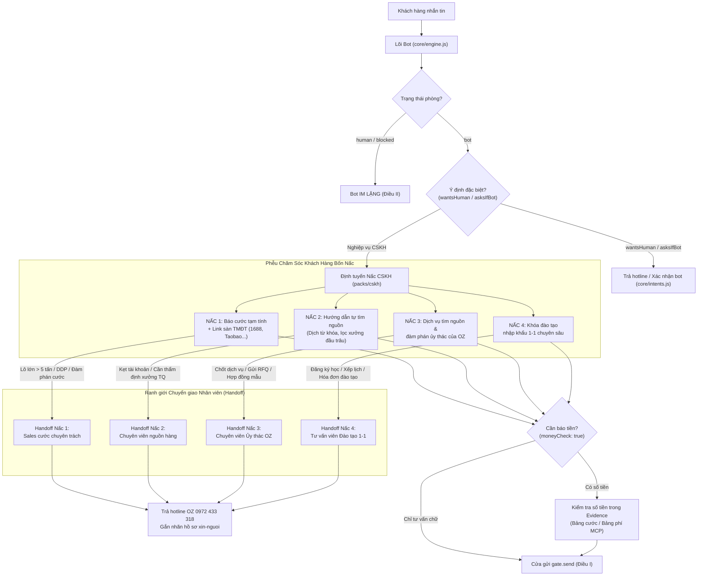

# Feature Specification: Gói CSKH bốn nấc (Customer Care 4-Tier Funnel)

**Feature Branch**: `003-cskh-bon-nac`

**Created**: 2026-11-10

**Status**: Draft (theo lộ trình `docs/ROADMAP.md:10-11,20-26`: `001 → 007 → 005`; `008 trước 003`; `003 trước 002`)

**Input**: Lộ trình phát triển hệ thống OZ Zalo Bot (`docs/ROADMAP.md:10-11`):
> "003: Gói CSKH bốn nấc (khách Fanpage/Zalo) — Báo giá tạm tính + link sàn → hướng dẫn tự tìm hàng → gói dịch vụ tìm nguồn → khoá học 1-1. Mỗi nấc có điểm chuyển người đo được. Điều kiện bắt đầu: 001 xong; eval ≥ 30 hội thoại thật; `moneyCheck: true`."

---

## Clarifications

### Session 2026-11-10 (Đúc kết từ Roadmap và 18 sự cố thực tế VPS 201)

- **Q: Tại sao Gói CSKH bốn nấc là gói có rủi ro vận hành cao nhất trong hệ thống?**
  - **A**: Theo ghi nhận tại `docs/ROADMAP.md:25-26` và `specs/001-nen-tang-chung/research.md:8-28`, toàn bộ 18 sự cố nghiêm trọng trong giai đoạn thử nghiệm VPS 201 (09–10/2026) đều tập trung ở mảng chăm sóc khách hàng: báo giá cước sai lệch (sự cố #6), bot chen ngang khi nhân viên đang gõ (sự cố #4), bot tự ý "chăm sóc lại" khi khách im lặng (sự cố #5), hứa gửi catalog vượt năng lực (sự cố #10), lộ đường dẫn tệp nội bộ (sự cố #7) và chuyển người nhưng không có ai tiếp nhận (sự cố #15). Do đó, Spec 003 phải đặt an toàn và kiểm soát ranh giới lên hàng đầu.
- **Q: Bốn nấc CSKH phục vụ phân khúc khách hàng nào và mang lại giá trị gì cho OZ?**
  - **A**:
    1. **Nấc 1 (Báo cước tạm tính + Link sàn TMĐT)**: Đón đầu lượng lớn khách mới bắt đầu tìm hiểu nhập hàng Trung Quốc. Cung cấp ngay mức cước minh bạch (kg/cbm) và link sàn phù hợp (1688, Taobao, Tmall, Alibaba) để giữ chân khách.
    2. **Nấc 2 (Hướng dẫn tự tìm nguồn hàng)**: Phục vụ khách muốn tự trải nghiệm mua hàng nhưng chưa biết cách lọc xưởng uy tín, dịch từ khóa hoặc tìm kiếm bằng hình ảnh.
    3. **Nấc 3 (Gói dịch vụ tìm nguồn & đàm phán ủy thác của OZ)**: Dành cho khách muốn an tâm tuyệt đối, ủy thác cho OZ đàm phán giá xuất xưởng rẻ hơn, kiểm tra chất lượng và nhập khẩu chính ngạch trọn gói A-Z.
    4. **Nấc 4 (Khóa đào tạo nhập khẩu 1-1 chuyên sâu)**: Dành cho chủ doanh nghiệp/nhà buôn muốn tự chủ 100% quy trình ngoại thương, tự đàm phán thanh toán và tự mở tờ khai hải quan trên VNACCS.
- **Q: Cơ chế bảo vệ số tiền (`moneyCheck: true`) hoạt động thế nào trong gói CSKH?**
  - **A**: Theo Hiến pháp III (`.specify/memory/constitution.md:21-25`), mọi con số về giá cước, phí dịch vụ ủy thác hay học phí đào tạo **bắt buộc phải do code tra cứu** từ bảng biểu phí cấu hình tĩnh hoặc công cụ MCP của Cổng OZ (`evidence`), tuyệt đối không để mô hình AI tự suy diễn hay phát sinh số tiền. Cửa gửi `core/gate.js` sẽ từ chối (`reject`) bất kỳ tin nhắn nào chứa số tiền không nằm trong `evidence` (`core/gate-decide.js:140-144`).
- **Q: Ranh giới chuyển giao nhân viên (`handoff`) được định nghĩa như thế nào tại từng nấc?**
  - **A**: Mỗi nấc có tiêu chí định lượng rõ ràng:
    - Nấc 1: Hàng dự án lớn (FCL, > 5 tấn), hàng hóa chất/nguy hiểm, hoặc khách đòi đàm phán giảm cước.
    - Nấc 2: Tài khoản sàn bị đóng băng/khóa, rào cản thanh toán quốc tế, hoặc yêu cầu thẩm định nhà máy thực địa tại Trung Quốc.
    - Nấc 3: Khách đồng ý sử dụng dịch vụ ủy thác, yêu cầu gửi hợp đồng mẫu, gửi RFQ chi tiết hoặc muốn đến văn phòng OZ làm việc.
    - Nấc 4: Khách đăng ký khóa học, hỏi lịch khai giảng, yêu cầu xuất hóa đơn VAT đào tạo.
    - Tại điểm handoff, gói trả về `handoff: { reason }`. Hệ thống tuân thủ quyết định của công ty (`docs/wiki/tien-do.md:89`, `core/engine-handoff.js:76-108`): cung cấp hotline OZ `0972 433 318`, gắn nhãn hồ sơ `xin-nguoi`. Nếu nhân viên trực tiếp gõ tay trên kênh (Spec 005), bot tự động im lặng 100%.
- **Q: Khách hàng im lặng thì bot có tự động gửi tin "chăm sóc lại" không?**
  - **A**: **Tuyệt đối KHÔNG** (Vi phạm Điều II Hiến pháp: "Khách im thì máy im: không nhắc lại, không 'chăm sóc lại' tự phát", `docs/ROADMAP.md:32`). Sự cố #5 tại VPS 201 cho thấy việc tự động nhắn tin sau 120 phút gây phản cảm và khiến khách chặn bot.
- **Q: Mối liên hệ giữa Spec 003 với Spec 008 (Cổng AI Studio) và Spec 004 (Học từ người trả lời) là gì?**
  - **A**:
    - Spec 008 cung cấp hạ tầng hàng đợi và kết nối AI Studio để sinh văn bản trả lời tự nhiên với chi phí 0 đồng (`brain.draft()`).
    - Spec 004 khai thác 1.451 tin nhắn nhân viên trả lời tay thực tế để hoàn thiện kho kịch bản eval và câu mẫu chuẩn.
    - Spec 003 là gói nghiệp vụ chạy trên nền tảng của Spec 001, thừa hưởng bộ lọc an toàn của `core/gate.js`.

---

## Bối cảnh & 18 sự cố vận hành VPS 201

CSKH là mảng có lượng tương tác lớn nhất nhưng cũng tiềm ẩn rủi ro thương hiệu cao nhất. Phân tích 18 sự cố tại `specs/001-nen-tang-chung/research.md:8-28` chỉ ra các bài học xương máu mà Spec 003 bắt buộc phải giải quyết triệt để:

| Sự cố # | Tình huống đo được trên VPS 201 | Nguy cơ khi triển khai CSKH bốn nấc | Giải pháp kiểm soát trong Spec 003 |
|---|---|---|---|
| **#2** | Một khách nhận 3 tin giống nhau trong 4 phút, bot tự giới thiệu lại 3 lần | Chào mời Nấc 1 lặp đi lặp lại khiến khách bực bội | Bộ chống trùng Jaccard 0.8 trong `core/gate-decide.js:124-130`, hàng đợi theo người `core/queue.js`. |
| **#3** | Lớp viết lại câu đè mất câu xin lỗi của nhân viên | Sửa đổi nội dung tư vấn giá hoặc cam kết dịch vụ | Cửa gửi `gate.send` chỉ duyệt gửi/từ chối, không sửa chữ (Điều I). |
| **#4** | 22 tin bot chen ngang sau tin nhân viên gõ tay | Bot nhảy vào tranh cãi giá cước khi sales đang chốt khách | Tích hợp cơ chế `detectsHumanReplies: true` từ Spec 005; phòng `human` thì bot im 100% (Điều II). |
| **#5** | Khách được báo giá rồi im, máy tự gửi lại sau 120 phút | Khách cảm thấy bị làm phiền, spam tin nhắn tiếp thị | Nghiêm cấm mọi tác vụ cron tự động gửi tin khi khách không tương tác mới (Điều II, `docs/ROADMAP.md:32`). |
| **#6** | Báo 27.000 đ/kg thay vì 25.650 đ/kg; đọc nhầm 1,5 tấn thành 1,5 kg | Sai lệch biểu cước Nấc 1, phí dịch vụ Nấc 3, học phí Nấc 4 | Bắt buộc `moneyCheck: true`: số tiền phải khớp với `evidence` từ bảng giá code tra (Điều III). |
| **#7, #8** | Lộ đường dẫn file nội bộ `/home/...` và token API | Lộ bảng giá nội bộ, chiết khấu đại lý hoặc thông tin đối tác | Kiểm tra rò rỉ bí mật qua `findLeak` tại cửa gửi (Điều IX). |
| **#9** | Khách hỏi "người hay AI" nhận câu trả lời né tránh | Mất lòng tin của khách hàng vào sự chuyên nghiệp của OZ | Lõi nhận diện `asksIfBot`, trả lời trung thực là trợ lý tự động OZ và gửi hotline (Điều VIII). |
| **#10** | Bot hứa "em gửi catalog" nhưng chỉ gửi được chữ | Khách chờ đợi tài liệu Nấc 2, Nấc 4 mà không nhận được | Không hứa vượt năng lực; chỉ gửi đường link bài viết web hoặc hotline nhân viên (Điều VIII). |
| **#15** | 87 khách để lại SĐT nhưng 0 cuộc gọi, xin người 100 lần | Khách chốt Nấc 3, Nấc 4 bị bỏ rơi, mất doanh thu | Mở phiếu gắn nhãn `xin-nguoi`, trả số hotline công ty để khách gọi ngay khi cần gấp. |
| **#16** | Tự chấm điểm tin nhắn 5.2/20 trong khi agent báo tốt | Ảo tưởng về chất lượng tư vấn 4 nấc | Xây dựng bộ kịch bản eval độc lập ≥ 30 hội thoại thực tế (`eval/run.mjs`). |

---

## Bảng đối chiếu 9 điều Hiến pháp

| Điều Hiến pháp | Ràng buộc nghiệp vụ đối với Spec 003 | Đánh giá tuân thủ |
|---|---|---|
| **I. Một cửa gửi** (NON-NEGOTIABLE) | Mọi tin nhắn phản hồi của 4 nấc CSKH đều phải trả về qua `handle()` và gửi qua `gate.send()`. Gói không tự gọi API gửi tin của kênh. | ✅ ĐẠT: Gói `packs/cskh/` chỉ trả `{ replies, evidence, handoff, labels, interests }`. |
| **II. Người trước máy** (NON-NEGOTIABLE) | Khi phòng chat ở trạng thái `human`, bot CSKH im hoàn toàn. Khi khách im lặng, tuyệt đối không tự động kích hoạt tin nhắn chăm sóc lại. | ✅ ĐẠT: Không có cron job gửi tin proactive ngoài lượt khách nhắn; tôn trọng trạng thái `human`. |
| **III. Số tiền do code tra** | Biểu cước Nấc 1, phí tìm nguồn Nấc 3 và học phí Nấc 4 phải tra từ bảng cấu hình hoặc công cụ MCP. Bật `moneyCheck: true`. | ✅ ĐẠT: Gói khai báo `moneyCheck: true`, mọi số tiền đều có mặt trong `evidence`. |
| **IV. Bằng chứng thắng lời khai** | Mọi lượt tư vấn CSKH đều ghi audit log đầy đủ (nấc tư vấn, công cụ đã gọi, bằng chứng giá, quyết định cửa). Eval độc lập ≥ 30 ca. | ✅ ĐẠT: Audit lưu SQLite, bộ eval tự động hóa 100% không dùng mock lỏng lẻo. |
| **V. Tri thức một nhà** | Biểu giá cước, danh mục sàn TMĐT, quy chuẩn hợp đồng ủy thác và giáo trình đào tạo đặt tại tệp dữ liệu chuẩn hoặc Cổng OZ MCP. | ✅ ĐẠT: Không nhúng biểu phí cứng vào câu prompt; đọc từ `packs/cskh/data/` hoặc MCP. |
| **VI. Đơn giản, không phụ thuộc** | Viết bằng Node.js thuần ESM, mỗi tệp dưới 300 dòng, không cài đặt thêm package npm runtime nào. | ✅ ĐẠT: Tách module theo từng nấc rõ ràng, code tinh gọn. |
| **VII. Sai thì dừng** | Khi không xác định được loại hàng hoặc bảng cước bị lỗi kết nối, bot không được bịa giá mà phải hỏi lại hoặc cung cấp hotline. | ✅ ĐẠT: Cơ chế fallback an toàn, không gửi tin sai lệch. |
| **VIII. Trung thực với khách** | Thừa nhận là bot khi được hỏi, không cam kết những việc ngoài khả năng (như cam kết chắc chắn 100% thời gian thông quan nếu có bão lũ). | ✅ ĐẠT: Tuân thủ `core/intents.js` và mẫu thông điệp chuẩn hóa. |
| **IX. Bí mật không bao giờ lộ** | Che số điện thoại cá nhân của khách hàng, che giá vốn gốc của nhà xe/hãng tàu, không lộ API key. | ✅ ĐẠT: Sử dụng `core/redact.js`, test chỉ dùng SĐT mẫu `0912345678`. |

---

## Chi tiết Nghiệp vụ 4 Nấc CSKH

---

### Nấc 1: Báo giá cước tạm tính + Link sàn thương mại điện tử

- **Mục tiêu**: Giải tỏa băn khoăn ban đầu về chi phí vận chuyển hàng từ Trung Quốc về Việt Nam, cung cấp ngay mức giá tham khảo theo bảng cước chuẩn và định hướng khách đến các sàn uy tín.
- **Dữ kiện cần thu thập**:
  1. Loại hàng hóa: Hàng bách hóa / tiêu dùng tổng hợp, hàng điện tử, mỹ phẩm, thực phẩm, hàng cồng kềnh.
  2. Tuyến vận chuyển: Quảng Châu/Bằng Tường → Hà Nội / TP.HCM.
  3. Phương thức: Vận chuyển đường bộ tiểu ngạch, vận chuyển chính ngạch (đường bộ / đường biển).
  4. Trọng lượng / Thể tích ước tính: Số kg hoặc số mét khối (CBM).
- **Quy tắc tính cước tạm tính (`moneyCheck: true`)**:
  - Tra cứu từ bảng giá chuẩn `packs/cskh/data/bieu-cuoc.json` hoặc công cụ MCP Cổng OZ `tra_cuoc_van_chuyen`.
  - Công thức: `Tổng cước tạm tính = Khối lượng (kg) × Đơn giá bậc tương ứng (VNĐ/kg)` hoặc `Thể tích (m³) × Đơn giá bậc (VNĐ/m³)`.
  - Luôn ghi rõ: "Giá cước tạm tính chưa bao gồm phí đóng gói gia cố (nếu có) và thuế nhập khẩu chính ngạch (nếu đi chính ngạch)".
- **Cung cấp link sàn TMĐT phù hợp**:
  - Khách mua sỉ, tìm xưởng sản xuất: Link sàn **1688.com** kèm gợi ý tìm kiếm.
  - Khách mua lẻ, thử mẫu, thời trang đa dạng: Link sàn **Taobao.com**.
  - Khách tìm thương hiệu cao cấp, chính hãng: Link sàn **Tmall.com**.
  - Khách tìm nhà xuất khẩu quốc tế lớn: Link sàn **Alibaba.com**.
- **Tiêu chí Handoff đo được ở Nấc 1**:
  - Lô hàng quy mô lớn: Khối lượng ≥ 5.000 kg (5 tấn) hoặc thể tích ≥ 30 CBM, hoặc yêu cầu vận chuyển nguyên container (FCL 20ft/40ft).
  - Hàng thuộc danh mục nhạy cảm/đặc biệt: Hóa chất nguy hiểm, pin năng lượng, hàng tươi sống cần bảo quản lạnh.
  - Khách yêu cầu báo giá DDP trọn gói (bao trọn thuế và thủ tục hải quan) mà không qua khai báo tờ khai thông thường.
  - Khách đưa ra yêu cầu giảm giá, mặc cả cước ("có bớt giá cước không", "cho giá đại lý").
  - **Hành động**: Trả `handoff: { reason: 'nac-1-cuoc-dac-biet' }` hoặc `handoff: { reason: 'nac-1-dam-phan-cuoc' }`, cung cấp hotline OZ `0972 433 318`, gắn nhãn `cskh-nac-1`, `hoi-cuoc-dac-biet`, `xin-nguoi`.

---

### Nấc 2: Hướng dẫn khách hàng tự tìm kiếm nguồn hàng

- **Mục tiêu**: Trao giá trị và tạo niềm tin bằng cách hướng dẫn khách hàng tự thao tác tìm nguồn hàng chất lượng cao trên các sàn TMĐT Trung Quốc mà không lo bị lừa đảo hay mua phải hàng kém chất lượng.
- **Nội dung hướng dẫn chuẩn hóa**:
  1. **Tìm kiếm bằng hình ảnh**: Hướng dẫn dùng ứng dụng 1688/Taobao trên điện thoại hoặc biểu tượng máy ảnh trên thanh tìm kiếm web máy tính để tải ảnh sản phẩm mẫu cần tìm.
  2. **Dịch từ khóa chuyên ngành**: Gợi ý dùng Google Dịch hoặc danh mục từ khóa tiếng Trung chuẩn theo ngành hàng (do OZ biên soạn sẵn trong tri thức gói).
  3. **Bộ 4 tiêu chí thẩm định xưởng uy tín trên 1688**:
     - *Biểu tượng Đầu trâu (牛头)*: Xưởng sản xuất trực tiếp đã được Alibaba xác minh thực địa và vốn điều lệ.
     - *Cấp bậc huân chương/kim cương*: Ưu tiên xưởng đạt từ 3 kim cương hoặc 1 vương miện trở lên.
     - *Thâm niên hoạt động*: Tối thiểu từ 3 năm trở lên trên sàn.
     - *Tỷ lệ khách quay lại mua (回头率)*: Tối thiểu đạt từ 20% trở lên.
  4. **Nhận diện shop trung gian (thương mại) vs Xưởng trực tiếp**:
     - Xem tên công ty có chữ "nhà máy / xưởng sản xuất" (制造, 制衣, 电子厂) thay vì "công ty thương mại" (贸易, 商贸).
- **Tiêu chí Handoff đo được ở Nấc 2**:
  - Khách gặp rào cản kỹ thuật nghiêm trọng: Bị khóa tài khoản Taobao/1688, tài khoản Alipay bị đóng băng không thể xác thực khuôn mặt, không thể thanh toán tiền hàng cho shop.
  - Khách yêu cầu thẩm định chuyên sâu tại xưởng: Cần người tới tận nhà máy ở Phật Sơn, Nghĩa Ô, Thâm Quyến để kiểm tra máy móc, kiểm định chất lượng lô hàng mẫu (Factory Audit).
  - Khách muốn nhờ đàm phán hợp đồng độc quyền mẫu mã.
  - **Hành động**: Gợi ý nâng cấp lên Nấc 3 (Dịch vụ tìm nguồn ủy thác trọn gói của OZ) hoặc trả `handoff: { reason: 'nac-2-ho-tro-tai-khoan' }`, gắn nhãn `cskh-nac-2`, `can-ho-tro-nguon`.

---

### Nấc 3: Gói dịch vụ tìm nguồn và đàm phán ủy thác của OZ

- **Mục tiêu**: Chuyển đổi khách hàng sang sử dụng dịch vụ ủy thác kinh doanh cốt lõi của OZ Việt Nam — giải quyết triệt để rào cản ngôn ngữ, thanh toán quốc tế và pháp lý hải quan.
- **Nội dung gói dịch vụ**:
  1. *Tìm kiếm và so sánh xưởng tận gốc*: Đội ngũ văn phòng OZ tại Quảng Châu/Bằng Tường trực tiếp liên hệ 3–5 xưởng sản xuất uy tín nhất để so sánh năng lực và chất lượng.
  2. *Đàm phán giá sỉ tối ưu*: Đàm phán trực tiếp bằng tiếng Trung, cam kết đàm phán được mức giá xuất xưởng tốt hơn giá niêm yết trên web từ 3%–10% đối với đơn số lượng lớn.
  3. *Đặt và kiểm định mẫu thực tế*: Hỗ trợ đặt hàng mẫu về văn phòng OZ tại Trung Quốc, quay video, chụp ảnh kiểm tra chất lượng trước khi đặt cọc toàn bộ lô hàng.
  4. *Ủy thác thanh toán ngoại thương*: Thanh toán tiền hàng qua hợp đồng ngoại thương hợp pháp, không rủi ro đóng băng tài khoản.
  5. *Vận chuyển chính ngạch & Xuất hóa đơn VAT*: Thông quan chính ngạch, xuất hóa đơn giá trị gia tăng đầy đủ, bảo vệ pháp lý kinh doanh tại Việt Nam.
- **Biểu phí dịch vụ minh bạch (`moneyCheck: true`)**:
  - Tra cứu từ bảng phí dịch vụ `packs/cskh/data/phi-dich-vu.json`:
    - Phí tìm nguồn & đàm phán ban đầu: Cố định hoặc miễn phí khi ký hợp đồng vận chuyển ủy thác.
    - Phí dịch vụ ủy thác nhập khẩu: Từ 1% – 3% giá trị lô hàng (tùy thuộc vào tổng giá trị đơn hàng, tối thiểu 2.000.000 VNĐ/hợp đồng).
- **Tiêu chí Handoff đo được ở Nấc 3**:
  - Khách đồng ý sử dụng dịch vụ và gửi bảng kê yêu cầu hàng hóa (RFQ), thông số kỹ thuật chi tiết, hoặc link sản phẩm mẫu muốn đàm phán.
  - Khách yêu cầu nhận bản hợp đồng ủy thác mẫu của OZ.
  - Khách muốn đến làm việc trực tiếp tại các văn phòng giao dịch của OZ (Hà Nội, Hải Phòng, TP.HCM).
  - **Hành động**: Trả `handoff: { reason: 'nac-3-chot-uy-thac' }`, thu thập thông tin vào `interests`, trả hotline OZ `0972 433 318`, gắn nhãn `cskh-nac-3`, `tiem-nang-uy-thac`, `xin-nguoi`.

---

### Nấc 4: Khóa đào tạo nhập khẩu 1-1 chuyên sâu

- **Mục tiêu**: Phục vụ các chủ doanh nghiệp, trưởng phòng thu mua và cá nhân muốn tự chủ 100% năng lực nhập khẩu hàng Trung Quốc chính ngạch, không cần qua trung gian.
- **Cấu trúc chương trình đào tạo "Thực chiến 1-1"**:
  - **Hình thức**: Kèm cặp 1-1 (1 giảng viên chuyên gia OZ kèm 1 học viên), học Online qua Google Meet / Zoom hoặc Offline tại văn phòng OZ. Thời gian học linh hoạt theo lịch học viên.
  - **5 Học phần thực chiến**:
    1. *Học phần 1: Nghệ thuật săn nguồn và đàm phán hợp đồng ngoại thương*: Khai thác sâu sàn 1688, tìm xưởng OEM/ODM, soạn thảo hợp đồng thương mại quốc tế (Sales Contract, Commercial Invoice, Packing List).
    2. *Học phần 2: Thanh toán quốc tế an toàn*: Phương thức T/T, L/C, Alipay doanh nghiệp, mở tài khoản ngân hàng và kiểm soát rủi ro tỷ giá tệ/đô.
    3. *Học phần 3: Phân loại mã HS, tính thuế và chính sách chuyên ngành*: Tra cứu mã HS chính xác, tính thuế NK/VAT/TTĐB, xử lý thủ tục kiểm tra chất lượng, công bố hợp quy.
    4. *Học phần 4: Thực hành phần mềm khai hải quan VNACCS/ECUS5*: Cầm tay chỉ việc truyền tờ khai thử và tờ khai thật trên hệ thống hải quan điện tử Việt Nam.
    5. *Học phần 5: Tối ưu chi phí logistics và xử lý tình huống phát sinh tại cửa khẩu*: Lựa chọn hãng tàu, forwarder, xử lý phân luồng Vàng/Đỏ và kiểm hóa thực tế.
  - **Cam kết đồng hành**: Hỗ trợ tư vấn trọn đời, bảo trợ thông quan cho lô hàng đầu tiên của học viên.
- **Thông tin học phí (`moneyCheck: true`)**:
  - Tra cứu từ `packs/cskh/data/hoc-phi-dao-tao.json`:
    - Học phí niêm yết chuẩn khóa 1-1 thực chiến (ví dụ: 15.000.000 VNĐ / khóa 10 buổi kèm 1-1).
    - Cam kết hoàn tiền 100% nếu sau buổi 2 học viên thấy không thực tế.
- **Tiêu chí Handoff đo được ở Nấc 4**:
  - Khách hàng muốn đăng ký khóa học, hỏi thời gian khai giảng hoặc yêu cầu xếp lịch tư vấn 1-1 với giảng viên.
  - Khách hàng yêu cầu xuất hóa đơn công ty (VAT) cho chi phí đào tạo.
  - Khách hàng muốn kiểm tra năng lực đầu vào hoặc xin học thử 1 buổi.
  - **Hành động**: Trả `handoff: { reason: 'nac-4-dang-ky-khoa-hoc' }`, thu thập nhu cầu vào `interests`, trả hotline OZ `0972 433 318`, gắn nhãn `cskh-nac-4`, `dang-ky-dao-tao`, `xin-nguoi`.

---

## Cơ chế chuyển nấc thông minh & Gắn nhãn hồ sơ

Hệ thống quản lý hành trình khách hàng qua 4 nấc một cách tự nhiên dựa trên ngữ cảnh hội thoại và nhu cầu bộc lộ của khách, đồng thời đồng bộ vào hồ sơ khách hàng `core/customers.js`:

1. **Từ Nấc 1 lên Nấc 2**: Khi khách đã nhận báo giá cước tạm tính và nhận link sàn, nếu khách hỏi thêm "làm sao biết shop nào uy tín", "tiếng Trung không biết thì tìm thế nào" → Hệ thống tự động chuyển sang kịch bản Nấc 2.
2. **Từ Nấc 2 lên Nấc 3**: Khi khách nhận hướng dẫn tự tìm nguồn nhưng phản hồi "nghe phức tạp quá", "sợ bị lừa", "bên em có làm trọn gói từ A-Z không", "tài khoản chị bị khóa rồi" → Hệ thống lập tức giới thiệu Gói dịch vụ tìm nguồn & đàm phán ủy thác của OZ (Nấc 3).
3. **Từ Nấc 3 lên Nấc 4**: Khi khách hỏi "bên em có dạy nghề không", "anh muốn tự mở công ty tự nhập khẩu luôn chứ không muốn thuê ngoài mãi" → Hệ thống giới thiệu Khóa đào tạo 1-1 thực chiến (Nấc 4).
4. **Gắn nhãn hồ sơ khách hàng (`labels`)**:
   - `cskh-nac-1`: Khách quan tâm cước vận chuyển.
   - `cskh-nac-2`: Khách tự tìm nguồn hàng.
   - `cskh-nac-3`: Khách có nhu cầu ủy thác tìm nguồn.
   - `cskh-nac-4`: Khách quan tâm khóa đào tạo.
   - `tiem-nang-cao`: Khách có quy mô đơn hàng lớn hoặc nhu cầu ủy thác rõ ràng.
   - `xin-nguoi`: Khách chạm ranh giới handoff tại bất kỳ nấc nào.

---

## User Scenarios & Acceptance Criteria

### User Story 1 — Báo cước tạm tính minh bạch và gợi ý link sàn (Nấc 1) (Priority: P1)

Là khách hàng mới bắt đầu tìm hiểu nhập hàng, tôi muốn gửi thông tin sơ bộ về mặt hàng và khối lượng để nhận báo giá cước vận chuyển tạm tính chuẩn xác kèm link sàn TMĐT phù hợp, giúp tôi ước tính chi phí trước khi quyết định mua hàng.

- **Independent Test**: Gửi tin nhắn "Tôi muốn nhập 50kg quần áo từ Quảng Châu về Hà Nội, giá cước sao em?". Bot tra cứu biểu cước chuẩn, tính toán và trả lời cước tạm tính kèm link 1688/Taobao, kiểm tra `moneyCheck: true` thông qua thành công.

**Acceptance Scenarios**:
1. **Given** khách hàng cung cấp loại hàng "quần áo", khối lượng "50 kg", tuyến "Quảng Châu - Hà Nội", **When** gói `cskh` xử lý, **Then** bot tra cứu biểu cước chuẩn, trả về con số cước tính toán chính xác (kèm con số trong `evidence`), kèm link sàn 1688.com/Taobao.com và gắn nhãn `cskh-nac-1`.
2. **Given** khách hàng chỉ hỏi chung chung "Cước vận chuyển từ Trung Quốc về tính thế nào?", **When** gói `cskh` xử lý, **Then** bot phản hồi khung cước tham khảo theo bậc (VNĐ/kg và VNĐ/m³) từ bảng giá chuẩn trong `evidence`, kèm câu hỏi hướng dẫn khách cung cấp loại hàng và khối lượng.
3. **Given** bot soạn câu trả lời có số tiền cước nhưng con số đó KHÔNG nằm trong `evidence`, **When** tin nhắn đi qua `gate.send`, **Then** cửa gửi từ chối với lý do `money:<số-tiền-lạ>` (Hiến pháp III).

---

### User Story 2 — Hướng dẫn tự tìm nguồn hàng và thẩm định xưởng (Nấc 2) (Priority: P1)

Là người mua hàng muốn tự tay chọn nguồn hàng trên 1688/Taobao, tôi muốn nhận được cẩm nang hướng dẫn cách tìm kiếm bằng hình ảnh, dịch từ khóa và các tiêu chí lọc xưởng sản xuất uy tín, để tôi tự tin mua hàng mà không sợ rủi ro.

- **Independent Test**: Gửi tin nhắn "Làm sao tìm được xưởng sản xuất uy tín trên 1688 vậy bot?". Bot phản hồi bộ 4 tiêu chí thẩm định xưởng (đầu trâu, thâm niên, tỷ lệ mua lại, huân chương) và hướng dẫn tìm bằng hình ảnh.

**Acceptance Scenarios**:
1. **Given** khách hỏi cách tìm nguồn hàng hoặc cách nhận biết shop uy tín trên 1688, **When** gói `cskh` xử lý, **Then** bot cung cấp 4 tiêu chí lọc xưởng (Đầu trâu, cấp bậc, thâm niên ≥ 3 năm, mua lại ≥ 20%) và link cẩm nang hướng dẫn.
2. **Given** khách hỏi từ khóa tiếng Trung cho một mặt hàng cụ thể (ví dụ: "máy ép nước mía tiếng Trung là gì"), **When** gói `cskh` xử lý, **Then** bot tra cứu hoặc đối chiếu từ khóa chuẩn xác và hướng dẫn dán vào thanh tìm kiếm 1688.
3. **Given** khách nói "tài khoản Taobao của tôi bị đóng băng rồi có tự mua được không", **When** gói `cskh` xử lý, **Then** bot nhận diện rào cản kỹ thuật, trả `handoff: { reason: 'nac-2-kẹt-tai-khoan' }` và gợi ý giải pháp ủy thác Nấc 3.

---

### User Story 3 — Tư vấn dịch vụ tìm nguồn & đàm phán ủy thác của OZ (Nấc 3) (Priority: P1)

Là chủ shop/doanh nghiệp muốn nhập khẩu chính ngạch an toàn, tôi muốn tìm hiểu quy trình dịch vụ tìm nguồn và biểu phí ủy thác trọn gói của OZ, để tôi có thể giao toàn bộ khâu đàm phán, thanh toán và thông quan cho OZ thực hiện.

- **Independent Test**: Gửi tin nhắn "OZ có dịch vụ tìm xưởng trọn gói từ A-Z không, phí tính thế nào?". Bot giới thiệu quy trình 5 bước, báo biểu phí ủy thác % chuẩn xác từ `evidence`, và gợi ý khách gửi thông tin mặt hàng.

**Acceptance Scenarios**:
1. **Given** khách hàng hỏi về dịch vụ tìm nguồn trọn gói của OZ, **When** gói `cskh` xử lý, **Then** bot trình bày quy trình 5 bước và biểu phí dịch vụ ủy thác từ bảng cấu hình chuẩn (`evidence`), gắn nhãn `cskh-nac-3`.
2. **Given** khách hàng gửi yêu cầu tìm nguồn cụ thể kèm số lượng (ví dụ: "Tôi cần tìm xưởng sản xuất balo học sinh số lượng 2.000 chiếc, gửi hợp đồng mẫu giúp tôi"), **When** gói `cskh` xử lý, **Then** bot ghi nhận mặt hàng vào `interests`, trả `handoff: { reason: 'nac-3-chot-uy-thac' }`, cung cấp hotline OZ và gắn nhãn `xin-nguoi`.

---

### User Story 4 — Đăng ký & tư vấn khóa đào tạo nhập khẩu 1-1 (Nấc 4) (Priority: P2)

Là nhà kinh doanh muốn tự chủ toàn diện thủ tục ngoại thương, tôi muốn tìm hiểu thông tin chi tiết về khóa đào tạo nhập khẩu 1-1 của OZ (học phần, hình thức học, học phí, chính sách hỗ trợ), để tôi đăng ký tham gia đào tạo.

- **Independent Test**: Gửi tin nhắn "Bên em có lớp dạy tự làm thủ tục hải quan và tự nhập hàng 1 kèm 1 không?". Bot phản hồi 5 học phần thực chiến, học phí chuẩn từ `evidence` và hotline tư vấn xếp lớp.

**Acceptance Scenarios**:
1. **Given** khách hàng hỏi về khóa đào tạo xuất nhập khẩu hoặc học thực hành khai báo hải quan, **When** gói `cskh` xử lý, **Then** bot tóm tắt 5 học phần thực chiến, hình thức kèm 1-1, học phí niêm yết chuẩn từ bảng dữ liệu trong `evidence`, gắn nhãn `cskh-nac-4`.
2. **Given** khách hàng nói "tôi muốn đăng ký học khóa 1-1, khi nào có lớp mới", **When** gói `cskh` xử lý, **Then** bot trả `handoff: { reason: 'nac-4-dang-ky-khoa-hoc' }`, cung cấp hotline OZ `0972 433 318` và gắn nhãn `xin-nguoi`.

---

### User Story 5 — Cơ chế Handoff chuyển giao an toàn và hotline hỗ trợ (Priority: P1)

Là nhân viên vận hành và khách hàng, tôi muốn khi phát sinh các yêu cầu phức tạp hoặc nhu cầu chốt dịch vụ tại bất kỳ nấc nào, hệ thống chuyển giao thông suốt tới nhân viên mà không làm gãy luồng và không gửi tin rác.

- **Independent Test**: Mô phỏng tình huống khách hàng yêu cầu gặp nhân viên hoặc đòi đàm phán hợp đồng đặc biệt. Bot trả `handoff`, lõi phản hồi hotline OZ và gắn nhãn `xin-nguoi`.

**Acceptance Scenarios**:
1. **Given** khách hàng kích hoạt ranh giới handoff tại Nấc 1, 2, 3 hoặc 4, **When** gói trả về `handoff: { reason }`, **Then** lõi gửi tin nhắn phản hồi chứa hotline `0972 433 318`, gắn nhãn `xin-nguoi`, và ghi audit `route`/`outbound` đầy đủ.
2. **Given** phòng đang ở trạng thái `human` do nhân viên đang tiếp quản, **When** khách hàng nhắn tin tiếp, **Then** bot tuân thủ nghiêm ngặt Điều II Hiến pháp: hoàn toàn im lặng, không gọi AI, không soạn nháp, không gửi tin chen ngang.

---

### User Story 6 — Phòng vệ số tiền và chống bịa đặt với moneyCheck (Priority: P1)

Là giám đốc kỹ thuật, tôi muốn mọi con số tiền trong toàn bộ 4 nấc CSKH phải được kiểm soát tuyệt đối thông qua `moneyCheck: true`, để loại trừ 100% nguy cơ bot tự bịa giá hoặc tính toán sai lệch gây thiệt hại uy tín.

- **Independent Test**: Tạo một câu phản hồi thử nghiệm cố tình chứa con số giá cước không có trong `evidence`. Cửa gửi `gate.send` lập tức từ chối gửi tin.

**Acceptance Scenarios**:
1. **Given** gói `cskh` được cấu hình `moneyCheck: true`, **When** phản hồi chứa bất kỳ số tiền nào (dạng số nguyên, dấu chấm phân cách hàng nghìn), **Then** cửa gửi `core/gate-decide.js` trích xuất danh sách số tiền và đối chiếu với tập `known` từ `evidence`.
2. **Given** có ít nhất một số tiền không xuất hiện trong `evidence`, **When** cửa gửi kiểm tra, **Then** tin nhắn bị trả về quyết định `reject` với mã lý do `money:<missing>`, ghi audit log cảnh báo.

---

## Edge Cases

1. **Khách hỏi nhiều nấc trong cùng một câu** (Ví dụ: "Giá cước bao nhiêu và bên em có dạy học không?"):
   - *Xử lý*: Trả lời trực tiếp phần cước Nấc 1 trước (rõ ràng, có số tiền trong evidence), sau đó tóm tắt giới thiệu Khóa học Nấc 4 và kèm lời mời tư vấn chi tiết.
2. **Khách cung cấp thông tin cước mơ hồ** (Ví dụ: "Hàng của anh nặng lắm, tính cước thế nào?"):
   - *Xử lý*: Không đoán khối lượng; cung cấp bảng cước mẫu theo bậc và lịch sự hỏi lại khối lượng cụ thể (kg hoặc m³) để tính chính xác.
3. **Khách hỏi mặt hàng thuộc diện cấm nhập khẩu** (Vũ khí, chất nổ, động vật quý hiếm, pháo hoa...):
   - *Xử lý*: Lập tức từ chối cung cấp dịch vụ vận chuyển/tìm nguồn cho mặt hàng này theo đúng quy định pháp luật Việt Nam, không đưa ra giá cước.
4. **Khách gửi ảnh sản phẩm cần tìm nguồn**:
   - *Xử lý*: Tiếp nhận ảnh, lưu URL ảnh vào hồ sơ, hướng dẫn khách cách dùng tính năng tìm kiếm bằng ảnh trên app 1688 (Nấc 2) hoặc chuyển sang dịch vụ tìm nguồn ủy thác OZ (Nấc 3).
5. **Khách im lặng sau khi nhận báo giá**:
   - *Xử lý*: Tuyệt đối không tự động nhắn tin nhắc lại (Điều II Hiến pháp). Chỉ tương tác khi khách chủ động nhắn tiếp.

---

## Functional Requirements (FR-001..FR-015)

- **FR-001**: Gói `packs/cskh/` MUST xuất khẩu mặc định một đối tượng gói hợp lệ theo `specs/001-nen-tang-chung/contracts/pack.md`, bao gồm: `id: 'cskh'`, `ten: 'CSKH bốn nấc'`, `audience: 'public'`, `priority: 20`, `moneyCheck: true`.
- **FR-002**: Gói `cskh` MUST nhận diện và định tuyến chính xác các nhu cầu tương ứng với 4 nấc CSKH thông qua bộ phân tích từ khóa và ngữ cảnh hội thoại.
- **FR-003**: Nấc 1 MUST tra cứu biểu cước từ dữ liệu chuẩn (`packs/cskh/data/bieu-cuoc.json` hoặc MCP Cổng OZ) và đưa toàn bộ các con số đơn giá, số lượng, tổng cước vào mảng `evidence`.
- **FR-004**: Nấc 1 MUST cung cấp đường dẫn truy cập hợp lệ tới các sàn TMĐT phù hợp (`1688.com`, `taobao.com`, `tmall.com`, `alibaba.com`).
- **FR-005**: Nấc 1 MUST kích hoạt handoff khi khách hàng yêu cầu vận chuyển lô hàng FCL, hàng ≥ 5 tấn, hàng nguy hiểm hoặc đàm phán giảm cước.
- **FR-006**: Nấc 2 MUST cung cấp bộ hướng dẫn tự tìm nguồn gồm: tìm kiếm bằng hình ảnh, dịch từ khóa tiếng Trung và bộ 4 tiêu chí lọc xưởng uy tín trên 1688 (đầu trâu, thâm niên ≥ 3 năm, cấp bậc, tỷ lệ mua lại ≥ 20%).
- **FR-007**: Nấc 2 MUST kích hoạt handoff hoặc đề xuất nâng lên Nấc 3 khi phát hiện khách hàng gặp sự cố đóng băng tài khoản hoặc yêu cầu thẩm định xưởng thực địa.
- **FR-008**: Nấc 3 MUST giới thiệu quy trình dịch vụ 5 bước của OZ và biểu phí ủy thác nhập khẩu từ bảng dữ liệu chuẩn trong `evidence`.
- **FR-009**: Nấc 3 MUST thu thập thông tin mặt hàng, số lượng dự kiến vào `interests` và kích hoạt handoff khi khách chốt yêu cầu dịch vụ hoặc đòi hợp đồng mẫu.
- **FR-010**: Nấc 4 MUST cung cấp cấu trúc 5 học phần thực chiến của khóa đào tạo 1-1 và học phí chuẩn hóa từ bảng dữ liệu trong `evidence`.
- **FR-011**: Nấc 4 MUST kích hoạt handoff khi khách hàng có nguyện vọng đăng ký học, kiểm tra lịch khai giảng hoặc yêu cầu xuất hóa đơn công ty.
- **FR-012**: Mọi trường hợp kích hoạt handoff MUST trả về đối tượng `handoff: { reason }` với `reason` ngắn gọn, súc tích (≤ 80 ký tự), không tự bịa đặt cam kết thời gian gọi lại của nhân viên.
- **FR-013**: Gói MUST tự động cập nhật nhãn tương ứng (`cskh-nac-1`, `cskh-nac-2`, `cskh-nac-3`, `cskh-nac-4`, `tiem-nang-cao`) vào mảng `labels` của kết quả lượt để đồng bộ hồ sơ khách hàng.
- **FR-014**: Khi phòng chat ở trạng thái `human`, gói MUST không được phép can thiệp hoặc phát sinh bất kỳ tin nhắn nào ra ngoài.
- **FR-015**: Khi khách hàng im lặng sau khi hoàn tất lượt tư vấn, hệ thống MUST không kích hoạt bất kỳ luồng quét hay tin nhắn tự phát nào (chặn đứng triệt để sự cố #5).

---

## Success Criteria (SC-001..SC-006)

- **SC-001**: 100% các tin nhắn báo giá cước (Nấc 1), phí dịch vụ (Nấc 3) và học phí (Nấc 4) có chứa số tiền đều vượt qua cổng kiểm tra `moneyCheck: true` của `core/gate.js` (0 lỗi `reject` vì `money:unbacked`).
- **SC-002**: 100% các ca biên cố tình đưa số tiền bịa đặt vào phản hồi của bot đều bị cửa gửi phát hiện và từ chối gửi tin thành công trong kiểm thử tự động.
- **SC-003**: 100% các tình huống chạm ranh giới handoff tại cả 4 nấc đều kích hoạt `handoff` chính xác, gắn nhãn `xin-nguoi` và cung cấp hotline OZ `0972 433 318`.
- **SC-004**: Không có bất kỳ tin nhắn tự phát nào được gửi ra khi khách hàng im lặng (0 tin nhắn proactive vi phạm Điều II Hiến pháp).
- **SC-005**: Bộ kịch bản eval độc lập đạt quy mô ≥ 30 hội thoại thực tế phủ trọn vẹn 4 nấc và các ca biên an toàn, đạt tỷ lệ vượt qua (pass rate) 100% trên `eval/run.mjs`.
- **SC-006**: Toàn bộ mã nguồn triển khai tuân thủ tuyệt đối Hiến pháp VI: 0 runtime dependency mới trong `package.json`, 100% tệp dưới 300 dòng, `npm test` và `node scripts/kiem-wiki.mjs --nghiem` đạt 100% xanh.
