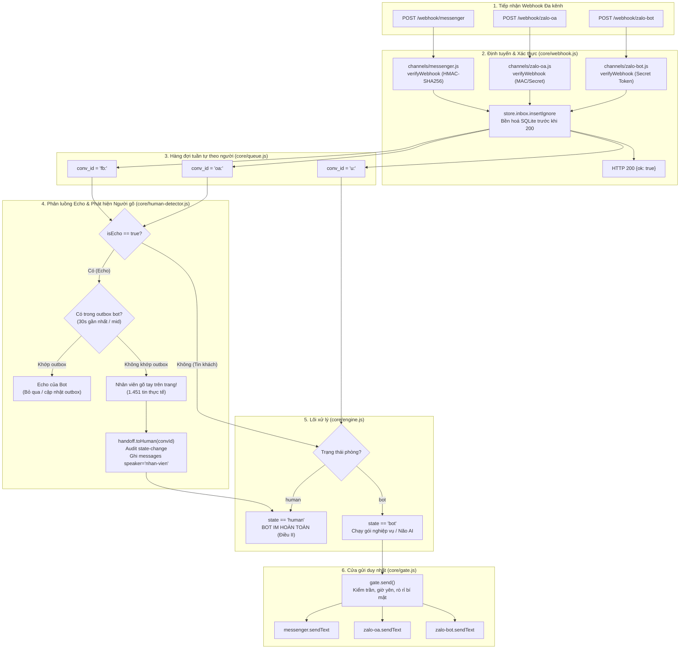

# Implementation Plan: Kênh thứ hai — Fanpage Messenger & Zalo OA

**Branch**: `005-kenh-thu-hai` | **Date**: 2026-11-09 | **Spec**: [spec.md](./spec.md)

**Input**: Feature specification from `/specs/005-kenh-thu-hai/spec.md`

---

## Summary

Hiện thực hóa kênh giao tiếp thứ hai đưa lõi bot OZ sang hai nền tảng có lưu lượng khách hàng lớn nhất hiện nay: **Meta Facebook Fanpage Messenger** và **Zalo Official Account (Zalo OA)**. Cả hai kênh đều tuân thủ nghiêm ngặt hợp đồng adapter kênh `specs/001-nen-tang-chung/contracts/channel.md:1-25`.

Trọng tâm đột phá của kiến trúc là khả năng tự động phát hiện nhân viên gõ tay trực tiếp trên trang (`detectsHumanReplies: true`): khi nhân viên CSKH trả lời khách trên giao diện Meta Business Suite hoặc Zalo OA, hệ thống bắt sự kiện phản chiếu (echo), đối chiếu với bảng `outbox` của bot trong SQLite. Nếu không phải tin do bot gửi, hệ thống tự động chuyển phòng sang trạng thái `'human'` qua `core/handoff.js`, ghi sổ audit, đặt lại khoảng lặng 2 giờ và giữ bot im lặng tuyệt đối theo Điều II Hiến pháp ("Người trước máy").

Toàn bộ hệ thống chạy trên nền Node.js ≥ 22.13 thuần túy, không thêm bất kỳ runtime dependency nào, mỗi tệp dưới 300 dòng (Điều VI), sử dụng chung một cửa gửi duy nhất `core/gate.js` (Điều I).

---

## Technical Context

**Language/Version**: JavaScript (ESM), Node.js ≥ 22.13 (Docker container `node:22-alpine`)

**Primary Dependencies**: 100% thư viện chuẩn Node.js, 0 dependency ngoài:
- `node:crypto`: Tạo băm HMAC-SHA256 xác thực chữ ký `x-hub-signature-256`, tạo sha1 cho `updateKey`, so sánh an toàn thời gian hằng `safeEqual`.
- `node:sqlite`: Sử dụng `DatabaseSync` từ `core/store.js` để đọc ghi `inbox`, `outbox`, `convs`, `messages`, `audit`.
- `node:test`, `node:assert`: Viết và chạy kiểm thử tự động TDD cho adapter và detector.
- `fetch`: Gọi API Meta Graph API (Send API v21.0) và Zalo OA OpenAPI v3.

**Storage**:
- Sử dụng trực tiếp `DATA_DIR/bot.db` hiện hữu của bot.
- Tận dụng cấu trúc bảng hiện tại:
  - `inbox`: Lưu trữ các webhook update thô của Messenger/Zalo OA trước khi ack 200.
  - `outbox`: Nguồn căn cứ đối chiếu lịch sử gửi tin của bot để phân biệt tin echo của bot vs tin gõ tay của nhân viên.
  - `convs`: Quản lý trạng thái theo người (`conv_id`), lưu trạng thái `'bot'` / `'human'` / `'blocked'`.
  - `messages`: Lưu vết hội thoại với `speaker: 'nhan-vien'` khi phát hiện người gõ tay trên trang.
  - `audit`: Ghi nhận sự kiện `state-change` khi phát hiện echo người gõ tay.

**Testing**:
- Unit test & Contract test: `node --test test/channels/messenger.test.mjs`, `node --test test/channels/zalo-oa.test.mjs`.
- Echo Detection & Handoff test: `node --test test/core/human-detector.test.mjs`, `node --test test/core/engine-human-echo.test.mjs`.
- Multi-channel Webhook test: `node --test test/core/webhook-multi-channel.test.mjs`.
- Toàn bộ test chạy ngoại tuyến với mock `fetchImpl`, không kết nối mạng thật.

**Target Platform**: Container Node.js chạy 24/7 trên máy chủ Linux/Docker, tiếp nhận webhook từ reverse proxy HTTPS (Nginx/Traefik).

**Constraints**:
- Tuân thủ 9 nguyên tắc Hiến pháp OZ Zalo Bot.
- Tuyệt đối không thêm package vào `package.json`.
- Mỗi tệp mã nguồn mới dưới 300 dòng (Điều VI).
- Mọi tin nhắn gửi ra khách phải qua đúng một hàm `gate.send()` (Điều I).
- Không làm gãy hành vi hiện tại của kênh `channels/zalo-bot.js` và 17 kịch bản eval hiện hữu.

---

## Constitution Check

*GATE: Kiểm tra mức độ tuân thủ 9 nguyên tắc Hiến pháp trước khi thiết kế chi tiết.*

| Điều | Đánh giá kiến trúc & Ràng buộc triển khai | Trạng thái |
|---|---|---|
| **I. Một cửa gửi** | Cả hai kênh `channels/messenger.js` và `channels/zalo-oa.js` chỉ cài đặt hàm `sendText(chatId, text)`. Hàm này chỉ được gọi bởi `core/gate.js:79`. Kênh không có quyền tự gọi API gửi tin ra khách. Cửa gửi tiếp tục kiểm soát trần tin, giờ yên, rò rỉ bí mật và kiểm tra số tiền. | ✅ ĐẠT |
| **II. Người trước máy** | Phát hiện tin nhân viên gõ tay trực tiếp trên trang qua sự kiện echo không có trong `outbox` → chuyển `conv_id` sang `'human'` ngay lập tức → bot im hoàn toàn (không gọi não AI, không soạn nháp, không gửi tin). Khoảng lặng 2 giờ được đặt lại qua `touch()`. | ✅ ĐẠT |
| **III. Số tiền do code tra** | Thừa hưởng nguyên vẹn từ tầng `core/gate.js`: cờ `moneyCheck: true` của các gói kiểm tra chặt chẽ số tiền trong tin gửi ra trên Messenger và Zalo OA. | ✅ ĐẠT |
| **IV. Bằng chứng thắng lời khai** | Mọi sự kiện echo phát hiện người gõ tay đều ghi audit `state-change` kèm lý do `echo-detected`. Mọi tin nhân viên được ghi vào bảng `messages`. Test suite chạy offline với mock `fetchImpl` kiểm tra đầy đủ các ca biên. | ✅ ĐẠT |
| **V. Tri thức một nhà** | Kênh chỉ làm nhiệm vụ adapter I/O: parse webhook payload và gọi HTTP Send API. Không chứa bất kỳ câu trả lời mẫu hay tri thức nghiệp vụ hải quan nào. | ✅ ĐẠT |
| **VI. Đơn giản, không phụ thuộc** | 0 dependency ngoài. Dùng `node:crypto` cho HMAC-SHA256 và `safeEqual`. Các module được module hóa độc lập: `channels/messenger.js` (< 280 dòng), `channels/zalo-oa.js` (< 280 dòng), `core/human-detector.js` (< 150 dòng). | ✅ ĐẠT |
| **VII. Sai thì dừng** | Chữ ký webhook sai → trả ngay HTTP 403. Nếu không chắc chắn tin echo là của bot hay của nhân viên, hệ thống luôn chọn phương án an toàn: coi như nhân viên gõ để bot nhường người (thà bot im còn hơn bot chen ngang). | ✅ ĐẠT |
| **VIII. Trung thực với khách** | Khách hỏi "người hay máy" trên Messenger hay Zalo OA đều được nhận câu trả lời chân thật `REPLY_IS_BOT` từ `core/intents.js`. | ✅ ĐẠT |
| **IX. Bí mật không bao giờ lộ** | Che `MESSENGER_PAGE_TOKEN`, `MESSENGER_APP_SECRET`, `ZALO_OA_SECRET` qua `core/redact.js`. Lỗi ném ra từ adapter chỉ mang `err.status`, không in token vào log hay gửi ra ngoài. Số điện thoại giả trong test chỉ dùng `0912345678`. | ✅ ĐẠT |

---

## Chi tiết Kiến trúc Kỹ thuật



---

### 1. Thiết kế Module Adapter Kênh Messenger (`channels/messenger.js`)

Tuân thủ đầy đủ giao diện `specs/001-nen-tang-chung/contracts/channel.md:1-25`:
- **Cấu hình khởi tạo**:
  ```js
  export function createChannel({
    pageToken,
    appSecret,
    verifyToken,
    baseUrl = 'https://graph.facebook.com/v21.0',
    fetchImpl = fetch,
  } = {})
  ```
- **Xác thực Webhook (`verifyWebhook(req)`)**:
  - `GET`: Kiểm tra `hub.mode === 'subscribe'` và `hub.verify_token === verifyToken` bằng `safeEqual`. Nếu đúng, trả về chuỗi `hub.challenge`.
  - `POST`: Đọc header `x-hub-signature-256`. Tính HMAC-SHA256 của raw request body với khóa `appSecret`. So sánh chữ ký bằng `safeEqual`.
- **Phân tích bản tin Webhook (`parse(raw)`)**:
  - Hỗ trợ payload chuẩn của Meta Webhook: `{ object: 'page', entry: [{ id, time, messaging: [...] }] }`.
  - Duyệt mảng `messaging` và chuẩn hóa thành đối tượng `Update`:
    - `updateKey`: `mid` của tin nhắn (hoặc sha1 của payload nếu không có `mid`).
    - `event`: `'message.text.received'`, `'message.photo.received'`, `'message.echo'`, `'message.unsend'`.
    - `chatId`: `sender.id` (nếu tin khách) hoặc `recipient.id` (nếu tin echo).
    - `userId`: PSID của khách hàng.
    - `text`: Nội dung văn bản `message.text`.
    - `photoUrl`: URL của attachment hình ảnh đầu tiên (`attachments[0].payload.url`).
    - `messageId`: `message.mid`.
    - `isEcho`: `Boolean(message.is_echo)`.
    - `appId`: `message.app_id ? String(message.app_id) : null`.
- **Gửi tin nhắn (`sendText(chatId, text)`)**:
  - Gọi POST `${baseUrl}/me/messages` với body `{ recipient: { id: chatId }, message: { text }, messaging_type: 'RESPONSE' }`.
  - Header: `Authorization: Bearer ${pageToken}`, `Content-Type: application/json`.
  - Giới hạn độ dài: `maxText: 2000` (cửa gửi `gate.send` đã chia đoạn sẵn).
- **Hành động gõ (`typing(chatId)`)**:
  - Gửi `sender_action: 'typing_on'` tới `${baseUrl}/me/messages`. Lỗi thì nuốt (catch and ignore).
- **Thuộc tính kênh**:
  - `name`: `'messenger'`
  - `maxText`: `2000`
  - `capabilities`: `{ detectsHumanReplies: true }`

---

### 2. Thiết kế Module Adapter Kênh Zalo OA (`channels/zalo-oa.js`)

Tuân thủ đầy đủ giao diện `specs/001-nen-tang-chung/contracts/channel.md:1-25`:
- **Cấu hình khởi tạo**:
  ```js
  export function createChannel({
    oaToken,
    oaSecret,
    baseUrl = 'https://openapi.zalo.me/v3.0/oa',
    fetchImpl = fetch,
  } = {})
  ```
- **Xác thực Webhook (`verifyWebhook(req)`)**:
  - Kiểm tra chữ ký MAC từ header `x-zevent-signature` hoặc secret token cấu hình với OA webhook qua `safeEqual`.
- **Phân tích bản tin Webhook (`parse(raw)`)**:
  - Nhận diện các sự kiện:
    - `user_send_text`: Tin khách gửi văn bản.
    - `user_send_image`: Tin khách gửi hình ảnh.
    - `oa_send_text`: Tin nhắn gửi từ OA (tin phản chiếu/echo).
  - Chuẩn hóa trường `isEcho = (raw.event_name === 'oa_send_text')`.
- **Gửi tin nhắn (`sendText(chatId, text)`)**:
  - Gọi POST `${baseUrl}/message/cs` (Customer Support message) với body `{ recipient: { user_id: chatId }, message: { text } }`.
  - Header: `access_token: ${oaToken}`, `Content-Type: application/json`.
- **Thuộc tính kênh**:
  - `name`: `'zalo-oa'`
  - `maxText`: `2000`
  - `capabilities`: `{ detectsHumanReplies: true }`

---

### 3. Thiết kế Cơ chế Đối chiếu Outbox & Phát hiện Người gõ tay (`core/human-detector.js`)

Module độc lập chịu trách nhiệm phân biệt tin bot echo với tin nhân viên gõ tay trực tiếp trên Fanpage/Zalo OA:
- **Nguyên lý hoạt động**:
  1. Khi nhận một `Update` có cờ `isEcho: true`:
  2. Tra cứu trong bảng `outbox` của SQLite:
     ```sql
     SELECT id, chat_id, text, sent_at, raw_response
     FROM outbox
     WHERE chat_id = ?
       AND status = 'sent'
       AND sent_at >= ?
     ORDER BY sent_at DESC
     LIMIT 5;
     ```
  3. Tiêu chí xác định tin của Bot (Bot Echo):
     - **Tiêu chí A (Khớp message_id)**: `raw_response` của dòng outbox chứa `message_id` trùng với `u.messageId`.
     - **Tiêu chí B (Khớp app_id)**: `u.appId` trùng với `config.fbAppId` của bot.
     - **Tiêu chí C (Khớp nội dung trong cửa sổ thời gian)**: Văn bản `u.text` trùng với nội dung dòng `outbox` vừa gửi trong vòng 30 giây gần nhất.
  4. Nếu KHÔNG khớp bất kỳ tiêu chí nào ở trên:
     - **Kết luận**: Đây là tin do nhân viên CSKH gõ tay trực tiếp trên Meta Business Suite hoặc Zalo OA!
     - Kích hoạt quy trình chuyển phòng sang `'human'` (Điều II).

---

### 4. Tích hợp Xử lý Người gõ tay vào Lõi (`core/engine.js`, `core/engine-handoff.js`)

Khi `engine.process(update)` nhận được một lượt:
1. Nếu `update.isEcho === true`:
   - Chạy hàm kiểm tra `detector.isHumanReply(update)`.
   - Nếu là tin bot echo: Đánh dấu `store.inbox.markDone(key)` và trả về `{ skipped: 'bot-echo', turnId: key }`.
   - Nếu là tin nhân viên gõ tay:
     - Gọi `handoff.toHuman(convId, 'nhan-vien-go-tay', 'echo-detected', { chatId: update.chatId })`.
     - Gọi `store.messages.add({ conv_id: convId, chat_id: update.chatId, turn_id: key, speaker: 'nhan-vien', speaker_id: 'page', text: update.text, at: update.receivedAt })`.
     - Gọi `handoff.touch(convId)` (đặt lại bộ đếm khoảng lặng 2 giờ).
     - Ghi audit bản ghi `state-change` và `echo-human`.
     - Đánh dấu hoàn thành inbox và trả về `{ handled: 'human-echo-detected', convId }`.
     - **Tuyệt đối không chạy gói nghiệp vụ và không gửi bất kỳ tin nào ra ngoài** (Điều II).

---

### 5. Thiết kế Định tuyến Đa kênh trên Webhook Handler (`core/webhook.js`, `server.js`)

Mở rộng `core/webhook.js` để hỗ trợ đa kênh linh hoạt:
- Hỗ trợ đăng ký nhiều adapter kênh qua Map kênh: `channels = new Map([['zalo-bot', chZalo], ['messenger', chFb], ['zalo-oa', chOa]])`.
- Phân luồng endpoint:
  - `POST /webhook/messenger` hoặc `GET /webhook/messenger` → định tuyến tới `channels.get('messenger')`.
  - `POST /webhook/zalo-oa` → định tuyến tới `channels.get('zalo-oa')`.
  - `POST /webhook` (hoặc `/webhook/zalo-bot`) → tương thích ngược 100% với kênh Zalo Bot Platform hiện tại.
- Định danh cuộc trò chuyện phân tách rõ ràng:
  - `channels/messenger.js`: `chatId` là PSID → `conv_id = 'fb:<psid>'`.
  - `channels/zalo-oa.js`: `chatId` là user_id → `conv_id = 'oa:<uid>'`.
  - `channels/zalo-bot.js`: `conv_id = 'u:<uid>'` hoặc `'g:<chatId>:<uid>'`.
  - Không bao giờ xảy ra xung đột khóa hàng đợi `convId` giữa khách hàng trên các kênh khác nhau.

---

## Project Structure & Planned Files

```text
specs/005-kenh-thu-hai/
├── spec.md                       # Đặc tả yêu cầu gốc
├── plan.md                       # Kế hoạch kiến trúc (tệp này)
└── tasks.md                      # Danh sách việc chi tiết T501–T508 kèm TDD

channels/
├── zalo-bot.js                   # Kênh Zalo Bot Platform hiện tại (giữ nguyên không đổi)
├── messenger.js                  # [MỚI - T501] Adapter kênh Fanpage Messenger (< 280 dòng)
└── zalo-oa.js                    # [MỚI - T502] Adapter kênh Zalo Official Account (< 280 dòng)

core/
├── human-detector.js             # [MỚI - T504] Kiểm tra đối chiếu outbox nhận diện người gõ tay (< 150 dòng)
├── webhook.js                    # [CẬP NHẬT - T506] Hỗ trợ định tuyến đa kênh và GET challenge (< 250 dòng)
├── engine.js                     # [CẬP NHẬT - T505] Nhận diện sự kiện echo và tích hợp handoff
└── engine-handoff.js             # [CẬP NHẬT - T505] Hỗ trợ chuyển trạng thái khi nhân viên gõ tay

test/
├── channels/
│   ├── messenger.test.mjs        # [MỚI - T501] Unit test & contract test cho Messenger adapter
│   └── zalo-oa.test.mjs          # [MỚI - T502] Unit test & contract test cho Zalo OA adapter
└── core/
    ├── channel-echo.test.mjs     # [MỚI - T503] Test cấu trúc Update và sự kiện Echo
    ├── human-detector.test.mjs   # [MỚI - T504] Test thuật toán đối chiếu outbox
    ├── engine-human-echo.test.mjs# [MỚI - T505] Test lõi engine tự im khi nhân viên gõ tay
    └── webhook-multi-channel.test.mjs # [MỚI - T506] Test định tuyến đa kênh trên HTTP server
```
